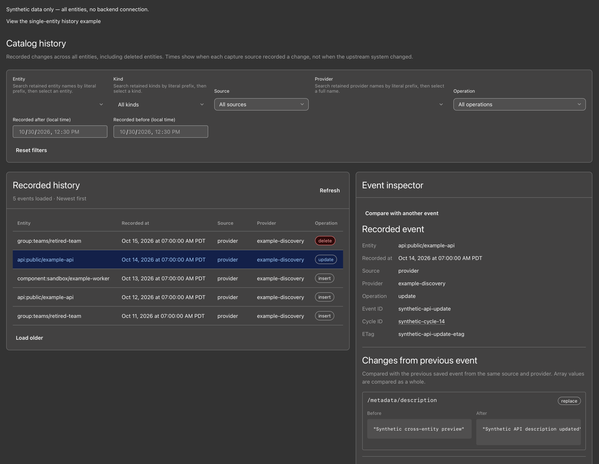

# @kunickiaj/backstage-plugin-catalog-backend-module-history

A Backstage module for recording and querying changes to catalog entities. It stores provider input, processor output, and snapshots from the Catalog API so you can inspect how an entity changed over time.

The default `HistoryStore` implementation uses PostgreSQL. You can supply another storage backend through a custom store.

**Status: pre-alpha.** All five public packages are published at `0.4.0` with the `latest` dist-tag, including the frontend package. `0.5.0` is prepared but not yet published. The HTTP read API and migration-log isolation fix ship in `0.2.0`. Read the [storage notes](packages/catalog-history-backend/README.md#migration-bookkeeping-in-020) and [migration guide](docs/migration.md) before using a shared catalog database.

Maintainers: see [Publishing packages](docs/publishing.md) for validation, npm trusted publishing, artifact verification, release notes, and recovery.

The `0.2.0` global-feed index builds during history startup and blocks writes to history while it builds. Before deploying it to a database with a large retained history, plan a maintenance window. See the [index upgrade notes](packages/catalog-history-backend/README.md#global-history-feed-index-in-020).

## What it does

1. **Bootstraps the history schema** in the consuming plugin's database, unless overridden. The schema contains history tables and provider coordination state. New installations keep migration records in a dedicated history log. Existing history-only `0.1.0` logs remain supported.
2. **Captures provider data** with `HistoryRecordingEntityProvider` (`source='provider'`). The wrapper records `full` and `delta` mutations as individual cycles. It logs history failures without rejecting a successful catalog mutation. A shared store coordinates baseline reads, catalog forwarding, and history commits across backend instances. Slow history delays later catalog writes for the same provider, including when conversion is off. This capture path suits entities supplied by a provider, such as Users and Groups from an identity directory.
3. **Optionally observes processing output** with `catalog.history.processing.enabled` (`source='processing'`). It observes processor mutations and entities emitted by processors, but cannot observe deletes or guarantee registration order across independent modules. It skips unchanged entities by hash and buffers changes, with a default flush threshold of 500 rows and a 10-second interval. The first processing cycle after enabling records the whole catalog as inserts under `source='processing'`. This one-time cost occurs because each source has its own baseline.
4. **Optionally reconciles the served catalog** (`source='reconciler'`). The in-process scheduler reads the public Catalog API, including stitched `relations`, `status.items`, and orphan state. When enabled, it runs hourly with a 10-minute timeout, a 30-second initial delay, and the task ID `catalog-history-reconcile`. The external CLI is available for isolated CronJobs or ad hoc runs.
5. **Optionally serves retained history** from the same store (`catalog.history.api.enabled`). The catalog module exposes authenticated, permission-controlled routes under `/api/catalog/history`, including a feed across entities that were later deleted. The routes use the existing backend plugin and database.



The screenshot shows synthetic data from the development preview. The [screenshot gallery](docs/screenshots/README.md) includes the entity timeline, event comparison, and instructions to reproduce these views.

## Known deletion-capture limitation

History records a delete only when a configured capture path observes it. Actions such as **Unregister** that remove entities or locations directly can bypass the provider wrapper, so they do not guarantee a delete event. Earlier retained events can remain readable on the global history page. They do not prove that deletion was captured or make history a complete audit log of catalog deletion actions.

The reconciler is disabled by default and runs hourly when enabled without a custom schedule. It needs its own earlier scan as a baseline. Provider and processing records do not supply that baseline.

It can later record an observed disappearance, but misses entities deleted before its first scan and deletions followed by recreation between scans. Its recorded time is the observation time, not the actual deletion time, and it cannot recover the deletion actor or payload.

## Install

```sh
yarn add @kunickiaj/backstage-plugin-catalog-backend-module-history @kunickiaj/backstage-plugin-catalog-history-node
```

## Wire it up

In your Backstage backend (`packages/backend/src/index.ts`):

```ts
import { createBackend } from '@backstage/backend-defaults';

const backend = createBackend();

// ... your other plugins / modules

backend.add(import('@backstage/plugin-catalog-backend'));
backend.add(
  import('@kunickiaj/backstage-plugin-catalog-backend-module-history'),
);

backend.start();
```

The module package default export installs the catalog backend module and the default Postgres `historyStoreServiceRef` factory from `@kunickiaj/backstage-plugin-catalog-history-storage-node`. It provides schema bootstrap, optional processor capture, optional scheduled reconciliation, and the opt-in HTTP read API.

In the catalog module where you create a provider, depend on `historyStoreServiceRef` and wrap each provider you want to record with `HistoryRecordingEntityProvider.fromConfig`. Each catalog module receives the same plugin-scoped store. The wrappers, processor capture, reconciler, and read API share the same database and schema initialization. A wrapper records only when `catalog.history.enabled` and `catalog.history.provider.enabled` are both on. When either setting is off, it forwards mutations without accessing the store. Choose the providers to wrap:

Enabled provider capture requires the store's `withProviderMutation` capability. If a custom store lacks it, the wrapper skips provider recording, logs the missing capability, and forwards the original mutation unchanged. Upgrade every backend instance before relying on cross-instance ordering. See [provider coordination](packages/catalog-backend-module-history/README.md#provider-mutation-ordering-in-050) for backpressure, migration, and recovery limits.

```ts
import { HistoryRecordingEntityProvider } from '@kunickiaj/backstage-plugin-catalog-backend-module-history';
import { historyStoreServiceRef } from '@kunickiaj/backstage-plugin-catalog-history-node';
import { OktaOrgEntityProvider } from '@backstage/plugin-catalog-backend-module-okta';

backend.add(
  createBackendModule({
    pluginId: 'catalog',
    moduleId: 'okta-with-history',
    register(reg) {
      reg.registerInit({
        deps: {
          catalog: catalogProcessingExtensionPoint,
          logger: coreServices.logger,
          config: coreServices.rootConfig,
          historyStore: historyStoreServiceRef,
        },
        async init({ catalog, logger, config, historyStore }) {
          const inner = OktaOrgEntityProvider.fromConfig(/* ... */);
          catalog.addEntityProvider(
            HistoryRecordingEntityProvider.fromConfig(config, {
              inner,
              store: historyStore,
              logger,
            }),
          );
        },
      });
    },
  }),
);
```

The default store opens its database client and runs migrations on first use. Resolving the service alone does not open a connection. With `catalog.history.enabled: false`, or with the API, provider, processing, reconciler, and retention layers all off, the module skips history database access and migrations. Otherwise, it prepares the schema at startup so migration errors fail startup.

The default factory registers a shutdown hook for the shared store. Shutdown flushes buffered processor capture and closes the coordination pool and any pool created for the deprecated `catalog.history.database` override. Backstage manages the lifetime of its own shared database pool.

## Config

The table lists the defaults. Enabling retention also requires `maxAge`.

```yaml
catalog:
  history:
    enabled: true

    # Deprecated compatibility path: write to a different Postgres instance
    # than Backstage's main catalog DB. Prefer a custom historyStoreServiceRef
    # factory for new dedicated-storage setups.
    database:
      client: pg
      connection: ${PG_HISTORY_URL}

    # Provider-layer recording via HistoryRecordingEntityProvider wrapper.
    provider:
      enabled: true

    # Processor-layer recording via HistoryRecordingCatalogProcessor.
    processing:
      enabled: false

    # Serve authenticated entity-history reads from the catalog backend.
    api:
      enabled: false
      # Default Postgres history-read statement limit in 0.3.0.
      queryTimeoutMs: 10000

    # Scheduled in-process reconciliation through the public Catalog API.
    reconciler:
      enabled: false
      schedule:
        frequency: { hours: 1 }
        timeout: { minutes: 10 }
        initialDelay: { seconds: 30 }

    # Scheduled removal of old history. Off by default and dry run first.
    retention:
      enabled: false
      maxAge: { days: 90 } # required when enabled
      dryRun: true
      batchSize: 1000
      schedule:
        frequency: { hours: 24 }
        timeout: { hours: 1 }
        initialDelay: { minutes: 5 }
```

| Key                                                | Default                    | Effect                                                                                                                                        |
| -------------------------------------------------- | -------------------------- | --------------------------------------------------------------------------------------------------------------------------------------------- |
| `catalog.history.enabled`                          | `true`                     | Master switch. Set to `false` to skip database access, schema bootstrap, the API, every capture layer, and retention.                         |
| `catalog.history.database`                         | unset                      | Deprecated history database override honored by the default store factory. Prefer custom `historyStoreServiceRef` factories for new setups.   |
| `catalog.history.database.client`                  | `pg`                       | Knex client for the deprecated history database override.                                                                                     |
| `catalog.history.database.connection`              | Backstage database service | Knex connection string or object for the deprecated history storage override. Treated as secret config.                                       |
| `catalog.history.provider`                         | unset                      | Provider-layer capture settings.                                                                                                              |
| `catalog.history.provider.enabled`                 | `true`                     | Gates provider-layer recording in wrappers built with `HistoryRecordingEntityProvider.fromConfig`.                                            |
| `catalog.history.processing`                       | unset                      | Processor-layer capture settings.                                                                                                             |
| `catalog.history.processing.enabled`               | `false`                    | Enables processor-layer capture via `HistoryRecordingCatalogProcessor`.                                                                       |
| `catalog.history.api`                              | unset                      | HTTP history API settings.                                                                                                                    |
| `catalog.history.api.enabled`                      | `false`                    | Enables entity history, version, and cross-entity change-feed routes under `/api/catalog/history`.                                            |
| `catalog.history.api.queryTimeoutMs`               | `10000`                    | `0.3.0`: per-SQL-statement timeout in milliseconds for history reads through the default Postgres store. `0` disables only this plugin limit. |
| `catalog.history.reconciler`                       | unset                      | Scheduled in-process reconciler settings.                                                                                                     |
| `catalog.history.reconciler.enabled`               | `false`                    | Enables scheduled in-process reconciliation.                                                                                                  |
| `catalog.history.reconciler.schedule`              | unset                      | Optional Backstage scheduler config; omitted uses the defaults below.                                                                         |
| `catalog.history.reconciler.schedule.frequency`    | `{ hours: 1 }`             | Scheduler frequency for the in-process reconciler.                                                                                            |
| `catalog.history.reconciler.schedule.timeout`      | `{ minutes: 10 }`          | Scheduler timeout for one reconcile run.                                                                                                      |
| `catalog.history.reconciler.schedule.initialDelay` | `{ seconds: 30 }`          | Delay before the first scheduled reconcile run.                                                                                               |
| `catalog.history.retention`                        | unset                      | Scheduled retention settings. See [Retention](#retention).                                                                                    |
| `catalog.history.retention.enabled`                | `false`                    | Enables the `catalog-history-retention` task. When `false`, nothing is scheduled.                                                             |
| `catalog.history.retention.maxAge`                 | none                       | Required when enabled. Duration object or ISO string such as `P90D`. Must be at least 1 day.                                                  |
| `catalog.history.retention.dryRun`                 | `true`                     | Logs what a run would remove without deleting. Set `false` to delete.                                                                         |
| `catalog.history.retention.batchSize`              | `1000`                     | Rows or cycles deleted per transaction. Integer from 1 through 10000.                                                                         |
| `catalog.history.retention.schedule`               | unset                      | Optional Backstage scheduler config. Omitted keys use the defaults below.                                                                     |
| `catalog.history.retention.schedule.frequency`     | `{ hours: 24 }`            | Scheduler frequency for retention.                                                                                                            |
| `catalog.history.retention.schedule.timeout`       | `{ hours: 1 }`             | Scheduler timeout for one retention run.                                                                                                      |
| `catalog.history.retention.schedule.initialDelay`  | `{ minutes: 5 }`           | Delay before the first retention run.                                                                                                         |

After `backend.add(import('@kunickiaj/backstage-plugin-catalog-backend-module-history'))`, processing capture and scheduled reconciliation need configuration only. They need no additional code wiring.

## Read history over HTTP in `0.2.0`

Enable the API in the existing catalog module. It uses the same history store and database as recording. Its route prefix is `/api/catalog/history`. Do not install a separate history backend plugin or use the previously planned `/api/catalog-history` prefix.

`0.3.0` adds `catalog.history.api.queryTimeoutMs`, which defaults to 10 seconds. It limits each history-read SQL statement in the default Postgres store. It does not bound the whole HTTP request. A detail lookup can run two statements with separate deadlines. A lower positive Postgres `statement_timeout` remains in effect. Setting this option to `0` removes the plugin limit and retains any database limit.

```yaml
catalog:
  history:
    api:
      enabled: true
```

The routes require user authentication and the `catalog-history.read` permission, exported as `catalogHistoryReadPermission` from `@kunickiaj/backstage-plugin-catalog-history-common`. When Backstage's permission framework is enabled, the policy must return an explicit `ALLOW`. `DENY` and conditional decisions are rejected. Without that framework, authenticated users follow Backstage's normal permission behavior.

```sh
curl -H 'Authorization: Bearer <TOKEN>' \
  'https://backstage.example.com/api/catalog/history/entities/User/default/alice/history?source=provider&limit=25'

curl -H 'Authorization: Bearer <TOKEN>' \
  'https://backstage.example.com/api/catalog/history/entities/User/default/alice/versions?changedAfter=2026-01-01T00:00:00Z'

curl -H 'Authorization: Bearer <TOKEN>' \
  'https://backstage.example.com/api/catalog/history/entities/User/default/alice/versions/42'
```

`GET /api/catalog/history/entities/:kind/:namespace/:name/history` returns all recorded changes, including `insert`, `update`, and `delete`. `GET /api/catalog/history/entities/:kind/:namespace/:name/versions` omits deletes and returns the latest representative for each `source`/`provider`/etag combination. It excludes null etags. `GET /api/catalog/history/changes` returns retained changes across entities. All list responses use the shared `{ items, nextCursor }` shape. Feed items include the affected entity's `entityRef`, `kind`, `namespace`, and `name`.

`GET /api/catalog/history/entities/:kind/:namespace/:name/versions/:id` returns the exact history row for the canonical entity reference and row ID, including provenance and snapshot. It can also include `previousVersion`, the immediately preceding saved row for the same entity, source, and provider, ordered by `changedAt` and then `id`. Etags do not deduplicate events. A delete row has no current snapshot, but `previousVersion` can provide the last saved snapshot from that source and provider.

For update rows with both snapshots available, `changes` contains field paths and before/after values computed from stored payload fields. Identity and etag noise are excluded, and arrays are compared as whole values rather than semantically. `changes` is absent when no prior saved snapshot can be compared, and an empty array means no saved field differences. This comparison uses retained snapshots and can differ from the delta sent by the original capture source.

Use a timeline item's `id` to inspect that event. Do not look it up by etag or use the versions list: an `A → B → A` sequence retains all three event occurrences.

The entity list routes accept `source` (`provider`, `processing`, or `reconciler`), `provider`, `changedAfter`, `changedBefore`, `limit`, and `cursor`. The history route also accepts `op` (`insert`, `update`, or `delete`). The change-feed route accepts those filters plus `entityRef` and `kind`. `entityRef` is an exact canonical entity reference, not a partial search. `kind` is an exact, case-insensitive match and supports custom kinds. Timestamps must be ISO 8601 instants. `limit` is a positive integer, defaults to `25`, and is capped at `100`. Cursors are opaque and paginate live data, not a frozen result set. Pass `nextCursor` as `cursor` unchanged, and reset pagination after changing filters or refreshing results. Unknown, empty, or repeated query parameters, invalid values, and the unsupported `owner` filter return `400`.

The detail route accepts no query parameters. Invalid, nonpositive, or out-of-range PostgreSQL bigint IDs return `400`. An absent row or an ID for another entity returns `404`. The API returns retained history for deleted entities and does not filter rows by current catalog visibility. An approved `catalog-history.read` permission grants access to all retained history, not only entities visible in the current catalog. An empty list is `200` with `items: []`. Errors are `401` for missing authentication, `403` for a rejected permission decision, and `500` for a sanitized backend failure. There are no stats or facets routes.

`0.3.0` populates saved-field summaries on the default Postgres entity timeline and selected-event detail. Owner, relations, status, and orphan flags compare the immediately preceding saved event from the same entity, source, and provider, even when that event falls outside the current page or filters. A flag is omitted if either recorded value or the comparison is unavailable. Known unchanged values produce `false`. Inserts, deletes, and updates without a comparable predecessor have empty summaries. Arrays are compared as whole, order-sensitive values, not graph semantics. The global feed, version lists, and nested predecessor summaries still return `{}`. The default Postgres query implementation in published `0.2.0` returns empty summaries.

### Read recording cycles in `0.3.0`

`GET /api/catalog/history/cycles` lists recorded capture cycles. It accepts exact `source`, `provider`, `op`, and `mutationType` filters, inclusive `startedAfter`, `startedBefore`, `finishedAfter`, and `finishedBefore` instants, `limit`, and `cursor`. `op` selects cycles with a retained changed-entity row of that operation. Cycles without an `op` filter include heartbeat cycles.

```sh
curl -H 'Authorization: Bearer <TOKEN>' \
  'https://backstage.example.com/api/catalog/history/cycles?source=provider&limit=25'

curl -H 'Authorization: Bearer <TOKEN>' \
  'https://backstage.example.com/api/catalog/history/cycles/00000000-0000-4000-8000-000000000001?limit=1'
```

`GET /api/catalog/history/cycles/:cycleId` returns the cycle header and its retained changed-entity rows. Its only query parameters are `limit` and `cursor`. Cycle IDs use hyphenated UUID form. Uppercase input is normalized to lowercase, and nil and other UUID versions are accepted. Limits default to `25` and cap at `100`. Unknown, empty, or repeated query parameters and invalid values return `400`.

The list sorts by stored start time and then UUID, newest first. Changed rows sort by stored change time and then bigint row ID, newest first. Cursors preserve PostgreSQL microseconds even though response timestamps use JavaScript Date precision. Forward the opaque cursor from the list or `changes` page without reconstructing it. List and change-page cursors are not interchangeable: they bind their filters or cycle ID, but allow a different page limit. Pages read live retained data rather than a fixed snapshot.

```json
{
  "cycle": {
    "cycleId": "00000000-0000-4000-8000-000000000001",
    "provider": "example-provider",
    "source": "provider",
    "mutationType": "delta",
    "startedAt": "2026-10-24T12:00:00.123Z",
    "finishedAt": "2026-10-24T12:00:01.123Z",
    "counts": { "inserted": 1, "updated": 2, "deleted": 0, "unchanged": 4 }
  },
  "changes": {
    "items": [
      {
        "id": "42",
        "entityRef": "component:default/example-service",
        "kind": "Component",
        "namespace": "default",
        "name": "example-service",
        "source": "provider",
        "provider": "example-provider",
        "op": "update",
        "cycleId": "00000000-0000-4000-8000-000000000001",
        "changedAt": "2026-10-24T12:00:01.123Z",
        "summary": {}
      }
    ],
    "nextCursor": "..."
  }
}
```

`counts` are totals recorded when the cycle ran: `inserted`, `updated`, `deleted`, and `unchanged`. They do not count the current catalog, the current page, or the retained rows. If older entity rows are removed, the recorded counts stay unchanged. An existing cycle with no retained changes returns `200` with `changes.items: []`, even if the cycle recorded activity. An unknown cycle returns `404`. Cycle change rows contain metadata. Use the exact entity-version route to retrieve a snapshot or an event's full details.

Cycle routes require the same user authentication and `catalog-history.read` authorization as the other history routes. An older backend returns `404`. A custom store without the relevant query capability returns `501` after authentication and authorization. Treat `401` and `403` as access failures.

### Read a retained observation as of a time in `0.3.0`

`GET /api/catalog/history/entities/:kind/:namespace/:name/as-of` returns the latest retained physical row for the canonical entity at or before `timestamp`. Its only query parameters are required `timestamp` and optional exact `source` and `provider`. `timestamp` must be an ISO 8601 instant with a valid calendar date.

```sh
curl -H 'Authorization: Bearer <TOKEN>' \
  'https://backstage.example.com/api/catalog/history/entities/Component/default/payment-api/as-of?timestamp=2026-10-24T12%3A00%3A00.123456Z&source=provider&provider=example-provider'
```

The request timestamp is returned unchanged as `asOf`. It can retain microseconds and an offset. Response `changedAt` values use the existing JavaScript Date precision, such as `2026-10-24T12:00:00.123Z`. When a row has a snapshot, the response includes it both as `version.snapshot` and as top-level `snapshot`. A selected delete row has no snapshot and does not fall back to an earlier live row.

Without `source`, the lookup can select the latest matching observation from any retained capture layer. It does not query the current catalog or reconstruct a past served-catalog state. Provider, processing, and reconciler snapshots each describe their own recorded layer and cannot substitute for one another. The database compares its native timestamp precision and breaks ties by descending bigint row ID.

If no eligible retained row exists, for example because the entity is unknown, the requested time precedes the first row, or retention removed earlier rows, the response is `200` with `{ entityRef, asOf }` and omits `version` and `snapshot`. The response means no eligible retained observation. It does not show that the entity never existed. Empty, repeated, unknown, or cycle-related query parameters return `400`. The endpoint accepts no pagination, operation, owner, changed-range, or cycle parameters.

The route requires the same authentication and `catalog-history.read` authorization as other history reads. A custom store without `getEntityAsOf` returns `501` only after authorization. An older backend without the route returns `404`. `401` and `403` are access failures.

### Compare two recorded events in `0.5.0`

`GET /api/catalog/history/entities/:kind/:namespace/:name/diff?from=row:<id>&to=row:<id>` compares two retained rows of the same entity. The response lists how `from` became `to`, in the requested order, together with both recorded versions.

```sh
curl -H 'Authorization: Bearer <TOKEN>' \
  'https://backstage.example.com/api/catalog/history/entities/Component/default/payment-api/diff?from=row:1042&to=row:1187'
```

The response has `entityRef`, `from`, `to`, and `changes`. Each change has a field `path`, an `op` of `add`, `remove`, or `replace`, and the `before` and `after` values. Arrays are compared as whole values. A delete row has no snapshot, so comparing from a delete shows every recorded field as added, and comparing to a delete shows every field as removed.

The two rows may come from different sources or providers. Each capture layer records different fields: provider snapshots usually have no relations or status, for example. A comparison across layers therefore reports those fields as added or removed even when nothing changed in the catalog. Check `from.source`, `from.provider`, `to.source`, and `to.provider` before reading such a diff.

Targets must have the form `row:<id>`. Any other target, a missing target, an invalid row ID, the same row twice, or any other query parameter returns `400`. A row that does not exist, was removed by retention, or belongs to another entity returns `404`. The route uses the same authentication and `catalog-history.read` authorization as other history reads. A custom store without `getEntityDiff` returns `501` after authorization, and an older backend without the route returns `404`.

### Provider discovery in `0.3.0`

`GET /api/catalog/history/providers` returns `{ items: string[], nextCursor? }` with distinct provider names from retained entity-history rows, including deletion records. It does not list current provider registrations or names represented only by empty recording cycles. This route uses the same user authentication and `catalog-history.read` permission as other history reads.

Search with an optional `prefix`. Matching is case-insensitive using PostgreSQL `LOWER`, and the prefix is literal: `%`, `_`, and backslash are ordinary characters. Prefix whitespace is preserved. An omitted or empty prefix lists the first names in scope. Names retain their stored spelling, case variants remain separate, and pages sort using PostgreSQL `C` collation. Search does not perform fuzzy or accent-insensitive matching.

Optional `source`, `entityRef`, `kind`, `op`, `changedAfter`, and `changedBefore` filters apply before name pagination. This endpoint does not accept exact `provider` or `owner` filters. `limit` defaults to 25 and is capped at 100. Forward the same prefix and context filters with the returned cursor. You can change only the limit. Provider-search cursors differ from timeline cursors, and pages reflect live retained data rather than a snapshot. This endpoint accepts an empty `prefix`. Other empty, unknown, and repeated parameters return errors.

The existing `provider` filter on history requests remains exact. Use a discovered full name unchanged when applying it. The optional `getProviders` query/API capability supports discovery without changing existing list responses. A custom store without the method returns `501` after authorization. An older backend returns `404`. The client propagates these statuses. `401` and `403` remain access failures.

### Entity and Kind discovery in `0.3.0`

`GET /api/catalog/history/entities` discovers identities from retained history.
It accepts optional `prefix`, `kind`, `source`, `provider`, `op`, `changedAfter`,
`changedBefore`, `limit`, and `cursor` parameters. For example:

```sh
curl 'https://backstage.example.com/api/catalog/history/entities?prefix=pay&kind=Component&source=provider&limit=25'
```

It returns a shared page whose items contain only identity metadata:

```json
{
  "items": [
    {
      "entityRef": "component:default/payment-api",
      "kind": "Component",
      "namespace": "default",
      "name": "payment-api"
    }
  ],
  "nextCursor": "..."
}
```

Filters select history rows before the service chooses the latest matching row
for each canonical entity reference, ordered by native `changed_at` and `id`.
The selected row supplies all four fields. Results include delete-only and
otherwise retained identities; they do not fetch live catalog data, infer a
current/deleted state, or return snapshots. `entityRef` and `owner` are not
accepted, so an already selected reference cannot narrow discovery.

Name prefixes are case-insensitive PostgreSQL `LOWER` matches using `C`
collation for comparison and ordering; case folding uses the database locale.
They are literal prefixes: `%`, `_`, and backslash are ordinary
characters; matching is not fuzzy, substring, whole-reference, or
accent-insensitive. Prefix whitespace is preserved and there is no new name
length limit. Omit `prefix`, or pass it empty, to receive the first identities
in scope. Other empty, unknown, and repeated parameters return `400`.

Results sort by folded name and then canonical reference, both with `C`
collation. Cursors are opaque, bind the prefix and all scope filters, and do
not bind the limit; changing only `limit` is allowed. Pages read live retained
data, not a consistent snapshot.

`GET /api/catalog/history/kinds` returns `{ items: string[], nextCursor? }`.
It accepts only optional `prefix`, `limit`, and `cursor`; it is unscoped by
entity, source, provider, operation, time, or owner filters. It lists all
retained kinds, including custom kinds represented only by deletes. Case
variants collapse into one item: the stored spelling that is smallest under
`C` collation. Kinds sort by their folded `C`-collated value. Its opaque cursor
binds the prefix, not an entity or event cursor. These choices do not include
event counts or current-kind status.

Both endpoints default to 25 choices per page and cap `limit` at 100. Follow
`nextCursor` to reach later choices; a short page limit does not limit how much
retained history PostgreSQL may scan or sort.

Both routes require authenticated access and the existing `catalog-history.read`
authorization. A custom store that omits `getEntities` or `getKinds` returns
`501` only after that authorization; a backend without the route returns
`404`. `401` and `403` are access failures, not unsupported discovery.

## Add the frontend History tab and page in `0.2.0`

`packages/catalog-history` contains `@kunickiaj/backstage-plugin-catalog-history`, the plugin for Backstage's New Frontend System (NFS). The package was introduced in `0.2.0` and is published at `0.4.0` with the other public packages. Install the exact published version for end-to-end tests in your Backstage app.

After installing the frontend package in your app workspace, enable the catalog read API and add the default NFS plugin to `createApp`:

```yaml
catalog:
  history:
    api:
      enabled: true
```

```ts
import { createApp } from '@backstage/frontend-defaults';
import catalogHistoryPlugin from '@kunickiaj/backstage-plugin-catalog-history';

export default createApp({
  features: [catalogHistoryPlugin],
});
```

The plugin adds a **History** entity tab at the `history` extension path and a navigation page at `/catalog-history` titled **Catalog history**. It uses Backstage UI (BUI) and needs the application's BUI stylesheet. The tab is scoped to its current entity and filters retained events by source, provider, operation, and recorded time. It does not provide entity-reference or kind filters.

The standalone page browses retained history across all entities, including deleted entities. Its table shows each affected entity's kind, namespace, and name, as does the entity-scoped table. It can filter by an exact entity reference, kind, source, provider, operation, and recorded time. In the published `0.2.0` and legacy text inputs, entity-reference short names default to `Component:default`; canonical references are preserved. Kind matching is case-insensitive and accepts custom kinds.

Text fields apply after 300 ms. Dropdowns and valid dates apply immediately. Date fields use local time and convert to ISO instants. An invalid date or range shows an error without changing results. Any filter change resets pagination. **Reset filters** clears filters and cancels pending text input.

Select a timeline row by pointer or keyboard to inspect its exact event. The responsive timeline and inspector panels show update field changes when available, plus raw JSON separately. Delete events remain tombstones with no current snapshot. When a prior saved snapshot is available, the inspector labels it as the last recorded snapshot before deletion and shows its provenance. The snapshot is not the deletion payload.

`0.3.0` also displays recorded metadata, spec, relations, status items, owner, memberships, parent, and orphan status as read-only fields. Missing values stay distinct from recorded empty values or `false`. The fields do not use values from the live catalog. Nested values remain available as JSON within their fields, alongside the complete raw snapshot.

The `0.3.0` provider picker searches retained provider names when opened, then debounces literal prefix suggestions by 300 ms. Selecting a returned full name applies the existing exact provider filter, preserving its case and whitespace. Typing a prefix leaves the current provider filter in place; it does not filter events or derive suggestions from loaded rows. Suggestions use the applied source, entity, kind, operation, and time context, with the first 25 names shown and a narrowing hint when more are available.

Custom APIs without discovery, or backends returning `404`/`501` for it, keep a labeled exact-name textbox. Authentication/access errors remain visible rather than disabling discovery as unsupported; other failures can be retried. Published `0.2.0` keeps its original exact-name provider input.

`0.3.0` also replaces the standalone page's entity-reference and Kind text inputs with retained-history pickers when their optional discovery APIs are supported. Search **Entity** by name prefix, then select a result labeled with its kind and namespace. The picker applies its full exact reference internally, including for identities retained only as deleted history. Selecting an entity also sets Kind. Choosing an incompatible Kind clears Entity. **All kinds** keeps Entity, and clearing Entity keeps Kind. Typing a prefix alone does not change the event filters.

**Kind** lists retained kinds independently of the active filters, with **Load more kinds** for later pages. Entity suggestions use applied kind, source, provider, operation, and time filters; they exclude the selected reference so alternatives remain discoverable. The two controls fall back independently to their legacy text inputs when the optional method is absent or returns `404`/`501`. They remain hidden on the already-scoped entity History tab.

In `0.3.0`, an inspector's **Cycle ID** links to its **Recording cycle**, the capture run or flushed batch that recorded the event. The view shows recorded source/provider identity, timing, totals, and paginated retained changes. Selecting a change opens its exact event, including changes to other entities. The last saved snapshot before deletion links to its own earlier cycle. Links use the public history route, including host mount overrides. Custom APIs without cycle lookup keep readable cycle-ID text.

Cycle URLs use `?cycleId=…` on the standalone page. **Back to catalog history** removes that parameter and keeps other query parameters. The filter form stays mounted while hidden, preserving Entity, Kind, provider, source, operation, and time controls when returning. Event pagination and inspector selection restart. A cycle with no retained changes still shows its recorded totals. The recorded totals are separate from the number of loaded changes.

The backend requires an authenticated user and, when permissions are enabled, an explicit `ALLOW` for `catalog-history.read`. A disabled, unreachable, or older backend without the route appears as a history `404`. Expired sessions return `401`, and rejected permission decisions return `403`. The standalone page shows a compatibility message when a custom history API does not implement the change feed (`501`). The entity tab remains available. Deleted entities may have retained API history, but the entity tab cannot open after the catalog entity itself is absent. The frontend has no statistics, facets, or as-of views. `0.5.0` adds a comparison of any two recorded events of one entity. See the [frontend package README](packages/catalog-history/README.md#compare-two-recorded-events-in-050).

See the [frontend package README](packages/catalog-history/README.md) for workspace use, NFS exports, and user-facing error guidance.

### Custom history storage

For custom storage, register your own service factory and use the named catalog module export instead of the default loader:

```ts
import { createServiceFactory } from '@backstage/backend-plugin-api';
import { historyStoreServiceRef } from '@kunickiaj/backstage-plugin-catalog-history-node';
import { catalogModuleHistory } from '@kunickiaj/backstage-plugin-catalog-backend-module-history';

const myHistoryStoreServiceFactory = createServiceFactory({
  service: historyStoreServiceRef,
  deps: {
    // your deps here
  },
  async factory() {
    return createMyHistoryStore();
  },
});

backend.add(catalogModuleHistory);
backend.add(myHistoryStoreServiceFactory);
```

## Metrics in `0.3.0`

`0.3.0` adds four optional OpenTelemetry instruments through Backstage's `MetricsService`:

- `catalog.history.capture.operation.duration`
- `catalog.history.storage.operation.duration`
- `catalog.history.query.operation.duration`
- `catalog.history.capture.last_success.timestamp`

The default Postgres store and module-created processing and reconciliation use metrics automatically. Pass the injected `metricsServiceRef` to provider wrappers to enable their metrics. Custom stores and manual calls use their existing no-op behavior when no metrics service is supplied. Histogram `count` supports operation and error rates without separate counters. Configure export at the backend root. See the [observability guide](docs/observability.md) for labels, bucket advice, wiring, and alert guidance.

## Query the history directly

PostgreSQL stores the history records in two tables:

- `catalog_history_cycles`: one row per recorded cycle, with `provider`, `source`, mutation type, timestamps, and `n_added` / `n_modified` / `n_removed` / `n_unchanged` aggregates.
- `catalog_history_entities`: one row per entity change, with structured columns (`entity_ref`, `kind`, `namespace`, `name`, `provider`, `source`, `op`, `etag`, `display_name`, `email`, `owner`, `parent`, `member_of`, `orphan`) plus JSONB `metadata`, `spec`, `relations`, and `status_items`.

Provider coordination uses a separate table, `catalog_history_provider_coordination`, to preserve stream order.

Example queries:

```sql
-- Who left the platform team between two cycles?
WITH before AS (
  SELECT entity_ref FROM catalog_history_entities
  WHERE cycle_id = '...' AND member_of ? 'group:default/platform'
),
after AS (
  SELECT entity_ref FROM catalog_history_entities
  WHERE cycle_id = '...' AND member_of ? 'group:default/platform'
)
SELECT entity_ref FROM before EXCEPT SELECT entity_ref FROM after;

-- Org chart as of a past timestamp.
SELECT DISTINCT ON (entity_ref) *
FROM catalog_history_entities
WHERE changed_at <= '2026-03-05'
ORDER BY entity_ref, changed_at DESC;

-- Compare origin truth vs served catalog truth for one entity.
SELECT DISTINCT ON (source)
  source, entity_ref, etag, relations, status_items, orphan, changed_at
FROM catalog_history_entities
WHERE entity_ref = 'user:default/alice'
  AND source IN ('provider', 'reconciler')
ORDER BY source, changed_at DESC;

-- Find relation changes in served catalog history.
WITH served AS (
  SELECT
    entity_ref,
    changed_at,
    relations,
    lag(relations) OVER (PARTITION BY entity_ref ORDER BY changed_at) AS previous_relations
  FROM catalog_history_entities
  WHERE source = 'reconciler'
)
SELECT entity_ref, changed_at, previous_relations, relations
FROM served
WHERE relations IS DISTINCT FROM previous_relations
  AND relations @> '[{"type":"ownedBy","targetRef":"group:default/platform"}]'::jsonb
ORDER BY changed_at DESC;
```

## Reconciler modes

The reconciler snapshots the live catalog and compares it with its own previously recorded state. It uses only `source='reconciler'` rows because etags from other capture layers are computed from different content and cannot be compared. Changes are recorded as a cycle with `provider='reconciler'` and `source='reconciler'`. Repeated runs are safe. An unchanged catalog records a heartbeat cycle. The first run records the whole catalog as inserts. This one-time cost also occurs when processing capture is first enabled.

Use scheduled in-process reconciliation when the task can run in the backend process:

```yaml
catalog:
  history:
    reconciler:
      enabled: true
```

Run the CLI manually or from a CronJob when the task must run outside the backend process:

```sh
env \
  BACKSTAGE_BASE_URL=https://backstage.example.com \
  BACKSTAGE_TOKEN=... \
  PG_CONNECTION_STRING=postgres://... \
  npx reconcile-catalog-history
```

## Retention

`0.4.0` adds retention. The module can run the `catalog-history-retention` task on one backend replica to remove old history. The task is off by default.

```yaml
catalog:
  history:
    retention:
      enabled: true
      maxAge: { days: 90 }
```

Each run computes a cutoff of now minus `maxAge`. A capture stream is the history for one entity reference, source, and provider. Retention keeps the newest row in each stream, even when that row is older than the cutoff. It removes all history for an entity only when every capture stream ended in a delete before the cutoff. It also removes cycles that finished before the cutoff and no longer have rows.

Runs are dry runs until you set `dryRun: false`. A dry run logs how many entity rows and cycles a real run would remove and changes nothing. Check those counts in the backend logs before you enable deletion. Deleting runs use transactions of at most `batchSize` rows or cycles and stop between batches when the scheduler timeout cancels the task. A stopped run logs a warning with counts of removed rows and cycles, and the next run continues. The first cleanup of a large history can take several runs. A dry run counts everything in one query that the timeout does not stop, so it can take longer than a deleting batch on large tables.

`maxAge` has no default and must be at least 1 day. Startup fails when retention is enabled with a missing or invalid `maxAge` or `batchSize`, or when the configured history store does not implement `planRetention` and `applyRetention`. The default PostgreSQL store implements both. Removed rows no longer appear in history reads, including as-of lookups. A change-feed request whose cursor points at a removed row returns `400`, and the client must start again from the first page. See [storage sizing](docs/sizing.md) for choosing a window.

## Documentation

- [Migrate from the historical single module](docs/migration.md)
- [Implementation plan](docs/plans/2026-05-11-catalog-history-backstage-module.md)
- [Productization roadmap](docs/plans/2026-07-05-catalog-history-productization-roadmap.md)
- [Benchmark fixture generator](docs/benchmark-fixtures.md)
- [Entity discovery evaluation](docs/entity-discovery-evaluation.md)
- [Storage sizing and retention planning](docs/sizing.md)
- [Operations runbook](docs/operations.md)
- [Contributing: checks and code quality limits](CONTRIBUTING.md)
- [Architecture](docs/ARCHITECTURE.md)
- [Observability in `0.3.0`](docs/observability.md)
- [`0.2.0` release and E2E setup](docs/releases/0.2.0.md)
- [`0.3.0` release preparation](docs/releases/0.3.0.md)
- [`0.4.0` release](docs/releases/0.4.0.md)
- [`0.5.0` release preparation](docs/releases/0.5.0.md)

## License

Apache-2.0
