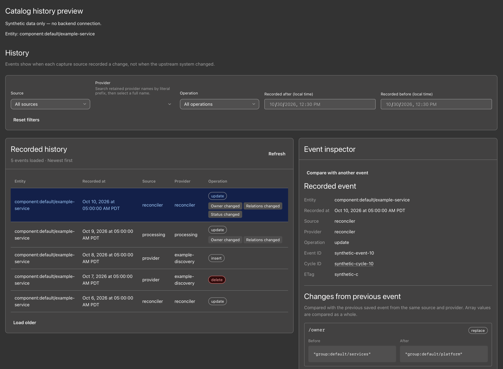
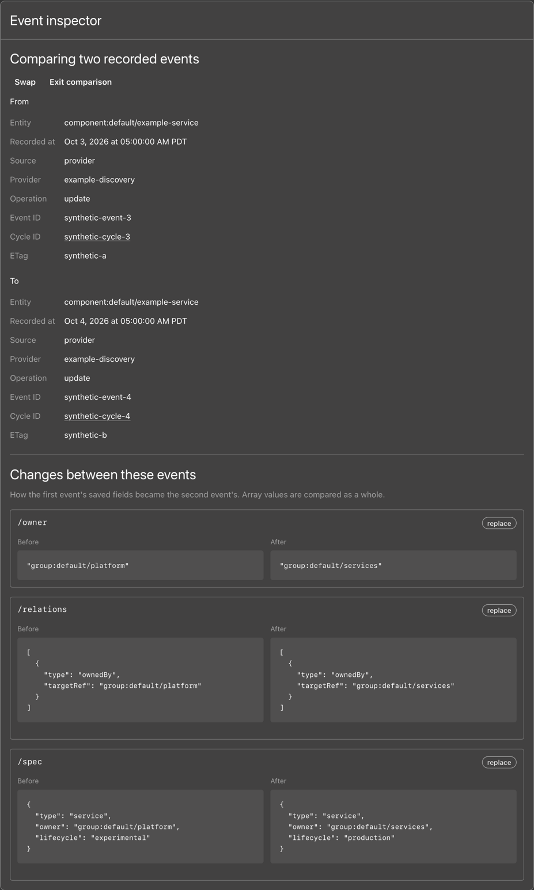

# Development preview screenshots

These screenshots show the current development preview with synthetic fixture data and no backend connection.

## Catalog history


The catalog-history page lists retained events across entity kinds. This fixture includes a deleted Group, and the inspector shows the selected API event and its recorded fields.

## Entity history



The entity-history view follows one entity. Its timeline includes provider, processing, and reconciler observations, and the inspector shows the selected event.

## Event comparison



The inspector compares two saved provider events for the same entity, showing owner, relation, and lifecycle changes. Event comparison is prepared for `0.5.0`. The latest published packages are `0.4.0`.

## Reproduce the preview

Use Node.js 22 or 24, then start the workspace:

```sh
yarn workspace @kunickiaj/backstage-plugin-catalog-history start
```

Open `http://localhost:3000/catalog-history` for the global feed and select the API update. Open `http://localhost:3000/entity-history` for an entity timeline and select its newest event to see the change badges and inspector.

For the comparison, choose **Load older**, select the October 3 provider event, choose **Compare with another event**, then select the October 4 provider event.

The first two captures use an 1800-pixel-wide viewport, crop out the dev navigation, and retain the synthetic-data banner. The comparison uses a 1200-pixel-wide viewport and captures only the inspector. All three use the preview's dark theme without changing its styles or fixture data.
